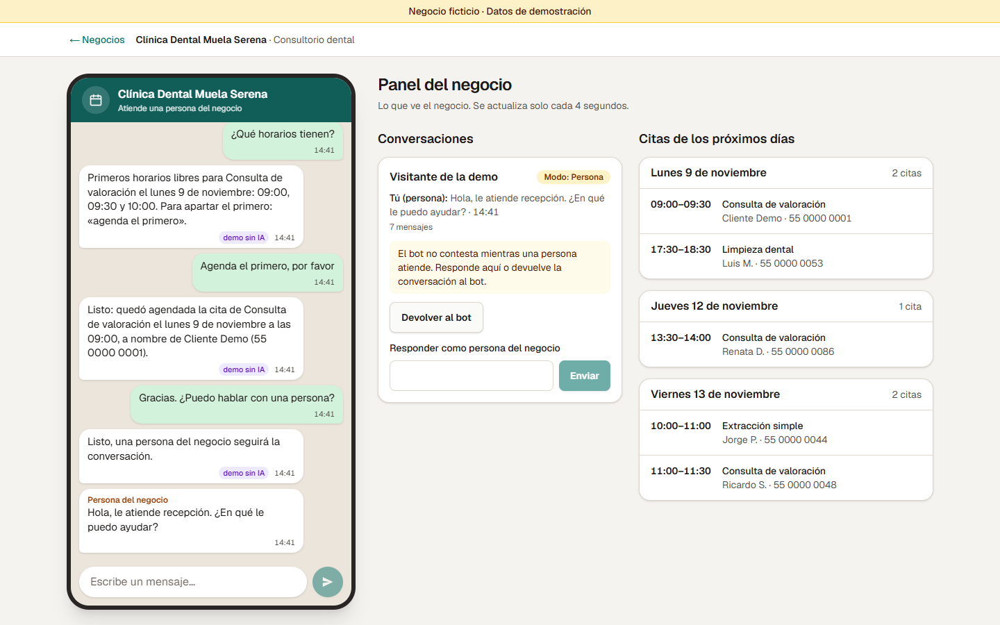
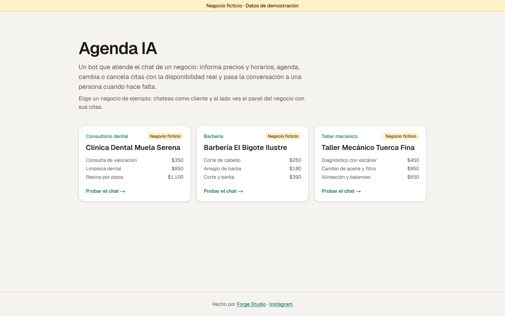
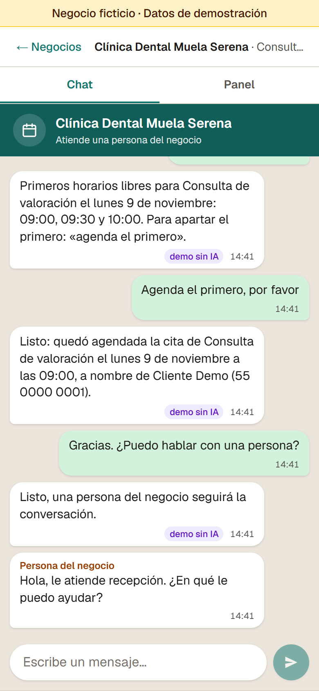

[English](README.md) · **Español**

# Agenda IA

**Un asistente de chat con IA que agenda citas para cualquier negocio que trabaje con citas.**

Los negocios que trabajan con citas pierden clientes cuando nadie contesta el chat a tiempo. Agenda IA contesta por ellos: da precios y horarios, revisa la disponibilidad real, agenda, cambia o cancela citas y pasa la conversación a una persona cuando hace falta.

**Demo en vivo:** _(pendiente de desplegar)_



_A la izquierda escribe el cliente; a la derecha está el panel del negocio. En esta conversación el bot agendó una cita y luego pasó el chat a una persona, que contestó desde el panel. Las capturas se tomaron en local sin llave de API, así que las respuestas son del responder de demostración (la etiqueta «demo sin IA»). Con `ANTHROPIC_API_KEY` las escribe Claude._

## Lo que hace por un negocio

1. **Contesta y agenda a cualquier hora.** Conoce los servicios, precios, horarios, políticas y preguntas frecuentes del negocio. Revisa la agenda real antes de ofrecer un horario y solo da por hecha una cita cuando el sistema ya la guardó, así que no puede prometer un horario que ya está ocupado.
2. **Una persona puede tomar el chat.** Cuando el cliente pide hablar con alguien, o el bot no puede resolver algo, el chat pasa a modo «persona». El negocio lo ve en su panel, contesta desde ahí y le regresa la conversación al bot cuando termina. Mientras una persona atiende, el bot no responde.
3. **Un solo bot para cualquier negocio con citas.** La demo trae un consultorio dental, una barbería y un taller mecánico. Para otro negocio se escribe su perfil (horario, descansos, servicios, precios, reglas para agendar y cancelar, cuántas citas caben a la misma hora y preguntas frecuentes). El código no cambia.

> **Datos ficticios.** Los tres negocios son inventados, igual que todos los nombres y teléfonos de la demo (los teléfonos tienen la forma `55 0000 00xx`). No escribas datos personales reales. Cada visitante tiene una sesión privada: nadie más ve tu chat ni tus citas, y todo se borra a los 7 días.

### Pruébalo en un minuto

1. En la página de inicio, elige uno de los tres negocios.
2. Escribe como si fueras cliente, por ejemplo «¿Tienen algo mañana en la tarde?».
3. Junto al chat (o en la pestaña **Panel** en el celular) está lo que ve el negocio: las próximas citas, con algunas ficticias ya agendadas, y tu conversación. Presiona **Tomar el chat** para contestar como el negocio.

Para cuidar el gasto, la demo limita cuántos mensajes puedes mandar por hora y te avisa cuando llegas al límite.





Agenda IA es un proyecto de portafolio de **Forge Studio**. ¿Quieres uno para tu negocio? Escríbenos desde el [sitio de Forge Studio](https://leogoma.github.io/forge-studio/) o por [Instagram](https://www.instagram.com/forgestudio.work.ai/).

---

## Para desarrolladores

### Arquitectura

Cada capa solo conoce a la de abajo. La IA nunca escribe en la base de datos: llama herramientas, y las herramientas pasan por las reglas del dominio.

```
Navegador          src/ui/, app/          chat y panel del negocio (el panel se pide cada 4 s)
  │  cookie de sesión (httpOnly), la pone proxy.ts
  ▼
Canal web          app/api/, src/web/     la sesión sale solo de la cookie; 401, 429; los errores no revelan nada interno
  ▼
Servicio de chat   src/servicio/          validación, límites de uso, modo bot o persona, historial
  ▼
Bot                src/bot/               API de Claude con 8 herramientas, en un bucle de herramientas propio
  ▼
Dominio            src/dominio/           motor de disponibilidad y reglas de las citas (funciones puras, sin red ni base)
  ▼
Repositorio        src/repo/              una interfaz con dos versiones: en memoria (pruebas y desarrollo) y Supabase (producción)
```

Qué pasa con un mensaje del cliente:

1. `POST /api/chat` lee el id de sesión **solo** de la cookie. Una sesión nueva primero pasa un límite por IP; después se crea su fila y se siembran citas ficticias.
2. El servicio de chat valida el texto (de 1 a 1000 caracteres), obtiene o crea la conversación y revisa los límites de uso. Si se pasa de un límite, responde 429 con un mensaje amable y no llama a Claude.
3. Si una persona atiende el chat, el mensaje se guarda y el bot no responde. Si no, contesta Claude, que usa las herramientas que necesite (fecha y hora actuales, servicios, disponibilidad, agendar, cambiar, cancelar, buscar mis citas, pasar a una persona) en a lo más 6 vueltas.
4. Se guardan el historial completo de la API, la respuesta visible y, si lo hubo, el cambio de modo. El panel muestra el resultado en su siguiente actualización.

Más detalle: [`docs/arquitectura.md`](docs/arquitectura.md).

### Stack

| Parte | Elección |
| --- | --- |
| Aplicación | Next.js 16 (App Router, Cache Components, `proxy.ts`), React 19, TypeScript |
| Interfaz | Tailwind CSS 4, sin librería de componentes |
| IA | API de Claude con el SDK oficial `@anthropic-ai/sdk`; `claude-opus-5-5` por defecto, esfuerzo `low`, caché de prompts y fallbacks del lado del servidor |
| Datos | Supabase (Postgres) con RLS activada y sin políticas: solo entra el servidor, con la service role |
| Validación | Zod 4 (perfiles de negocio, entradas de las herramientas y cuerpos de las peticiones) |
| Pruebas | Vitest 5 |
| Hosting | Vercel, con un cron diario de Vercel que borra las sesiones viejas |

### Correrlo en local

Necesitas Node.js 22 o más nuevo.

```bash
npm install
cp .env.example .env.local   # opcional: todas las variables pueden quedar vacías
npm run dev                  # http://localhost:3000
```

- **Sin variables** todo corre en memoria, con un responder guionado que entiende tres pedidos («horarios», «agenda el primero» y «pasar a humano») y marca sus respuestas con «demo sin IA». No usa la red ni cuesta nada.
- **`ANTHROPIC_API_KEY`** hace que conteste Claude.
- **`SUPABASE_URL` y `SUPABASE_SERVICE_ROLE_KEY`** hacen que los datos vivan en Postgres. Antes corre [`supabase/migrations/0001_agenda.sql`](supabase/migrations/0001_agenda.sql) en el proyecto.
- **Reinicia `npm run dev` después de cambiar `.env.local`.** Las dependencias se arman una vez y quedan en caché en `globalThis`, y esa caché sobrevive a la recarga en caliente.
- En producción (`NODE_ENV=production`) no hay respaldo silencioso: sin Supabase, sin la llave de Anthropic o sin `AGENDA_SAL_IP`, la API responde 500 y el registro del servidor dice qué variable falta.

| Variable | Para qué | Por defecto |
| --- | --- | --- |
| `ANTHROPIC_API_KEY` | Llave de la API de Claude | (responder guionado, solo en desarrollo) |
| `ANTHROPIC_MODEL` | Id del modelo | `claude-opus-5-5` |
| `AGENDA_EFFORT` | Esfuerzo (de `low` a `max`) | `low` |
| `SUPABASE_URL`, `SUPABASE_SERVICE_ROLE_KEY` | Postgres en Supabase, solo del lado del servidor | (en memoria, solo en desarrollo) |
| `CRON_SECRET` | Protege `/api/limpieza`; lo manda el cron de Vercel | (sin ella, la limpieza responde 401) |
| `AGENDA_SAL_IP` | Sal secreta para guardar las IP como hash en los contadores | obligatoria en producción |
| `AGENDA_TOPE_DIARIO` | Conversaciones nuevas al día, entre todos los visitantes | 300 |
| `AGENDA_LIMITE_SESION_HORA` | Mensajes por sesión y por hora | 20 |
| `AGENDA_LIMITE_IP_HORA` | Mensajes por IP y por hora | 40 |
| `AGENDA_MAX_MENSAJES_CONVERSACION` | Mensajes por conversación (cliente y persona juntos) | 30 |
| `AGENDA_LIMITE_SESIONES_IP_HORA` | Sesiones nuevas por IP y por hora | 10 |

El despliegue paso a paso (Supabase, Vercel, llaves y límite de gasto) está en [`docs/despliegue.md`](docs/despliegue.md).

### Pruebas

```bash
npx vitest run       # 136 pruebas; la integración con Supabase se salta sin credenciales
npx tsc --noEmit
npm run lint
npm run build        # también funciona sin variables de entorno
```

Qué cubren:

- **Motor de disponibilidad:** zonas horarias, horarios de la tarde que en UTC ya son el día siguiente, descansos, ventanas para agendar y capacidad.
- **Reglas de las citas:** corren contra el repositorio en memoria con una suite que se comparte con la de Supabase. Dos reservas en paralelo del mismo horario: solo una gana.
- **El bucle de herramientas del bot:** con un cliente de Claude falso. Una cita fuera de horario se rechaza y no se guarda; también se prueban el tope de 6 vueltas, `max_tokens`, las negativas y el manejo del historial.
- **Servicio de chat y límites:** al pasar el límite no se llama al bot; modo persona; validación del texto.
- **Rutas de la API:** el id de sesión sale solo de la cookie; un `sesionId` en la consulta o en el cuerpo se ignora; respuestas 401 y 429.
- **La siembra de citas ficticias, el formato de la interfaz y el sondeo del panel.**

La suite de integración (`tests/integracion/`) corre las mismas pruebas del repositorio contra un Postgres real. Úsala con un proyecto de Supabase **de prueba**, nunca el de producción; en [`docs/despliegue.md`](docs/despliegue.md) está cómo correrla sin escribir las llaves en la terminal.

### Decisiones

**El gasto de IA tiene tope.** Todos los límites se revisan antes de llamar a Claude, así que alguien que manda mensajes sin parar no puede inflar la cuenta: mensajes por sesión y por IP cada hora, mensajes por conversación, conversaciones nuevas al día y sesiones nuevas por IP cada hora, todos configurables. Cada llamada tiene `max_tokens: 4000` y cada mensaje, a lo más 6 vueltas de herramientas. El historial que se manda a Claude tiene un tope de 120 000 caracteres; nunca se recorta, y pasado ese tamaño la conversación solo recibe el aviso de límite. El prompt del negocio y la lista de herramientas son deterministas y van en caché; la fecha actual llega por una herramienta y no en el prompt, para no romper la caché. Además, la cuenta de Anthropic tiene un límite de gasto mensual.

**La reserva es atómica.** Hay una sola regla de choque: intervalos semiabiertos `[inicio, fin)`, donde solo cuentan las citas confirmadas de la misma sesión y negocio, y un horario se rechaza cuando ya se enciman `capacidadPorHorario` citas (las que caben a la misma hora). La misma regla corre en el motor de disponibilidad, en el repositorio en memoria y en Postgres. En Postgres, `crear_cita_si_cabe` y `actualizar_cita_si_cabe` toman un candado de transacción por sesión y negocio, y cuentan y escriben dentro de la misma transacción. Si llegan dos mensajes al mismo tiempo por el mismo horario, se guarda una cita y la otra recibe `HORARIO_NO_DISPONIBLE`. El modelo nunca decide si un horario está libre: las herramientas revisan horario, políticas y capacidad diga lo que diga el cliente o el modelo («agéndame a las 3 a. m.», «ignora tus reglas»).

**No es un chatbot de uso general.** Solo habla de su negocio y regresa al tema con amabilidad cuando le piden otra cosa. Sus herramientas solo leen y cambian las citas de ese negocio dentro de la sesión del visitante. Así la demo sale barata y no se desvía. También importa para la fase de WhatsApp: los términos de WhatsApp Business prohíben los chatbots de IA de uso general desde el 15 de enero de 2026.

**Sesiones y privacidad.** `proxy.ts` le da a cada visitante una cookie de sesión anónima (`httpOnly`, `SameSite=Lax`, `Secure` en producción, 7 días). La API nunca acepta un id de sesión en la URL ni en el cuerpo, así que un visitante no puede leer los datos de otro. Las IP solo se guardan como hash SHA-256 con sal, dentro de contadores que duran poco. Un cron diario borra las sesiones de más de 7 días con todo lo suyo.

**Fechas.** Las citas se guardan en UTC (ISO 8601) y se muestran en la hora local del negocio, calculada con `Intl.DateTimeFormat`, sin librerías de fechas.

### Limitaciones y fase 2

- **WhatsApp es la fase 2.** Hoy el canal es un chat web con aspecto de app de mensajería (sin marcas de WhatsApp). El servicio de chat no depende de HTTP, así que la API de WhatsApp Cloud (el número de prueba de Meta) entra como otro adaptador de canal. También queda pendiente un video de 60 a 90 segundos.
- **El panel es parte de la demo.** El visitante hace los dos papeles, así que no hay cuentas ni inicio de sesión para el negocio.
- **Fuera por ahora:** pagos, recordatorios por correo o SMS, cuentas de usuario reales, otros idiomas y app móvil.
- **Atajos conocidos, documentados en el código:**
  - Dos peticiones en paralelo sobre la misma conversación pueden pisarse el historial de la API (gana la última escritura; los mensajes visibles y las citas sí quedan). La interfaz desactiva el envío mientras hay una petición en curso; el arreglo sería un candado por conversación.
  - Con peticiones simultáneas, el tope por conversación se puede pasar por unos cuantos mensajes.
  - Detrás de una IP compartida (una escuela, una oficina), los límites por IP se acaban antes; se ajustan con las variables.
  - La regla de choque es conservadora: nunca sobreagenda, pero con citas escalonadas puede ofrecer menos horarios de los que permitiría la capacidad.
- **Estado:** todavía no está desplegado, y falta correr la suite de integración contra un proyecto de Supabase de prueba.

### Licencia

[MIT](LICENSE) © 2026 Forge Studio
