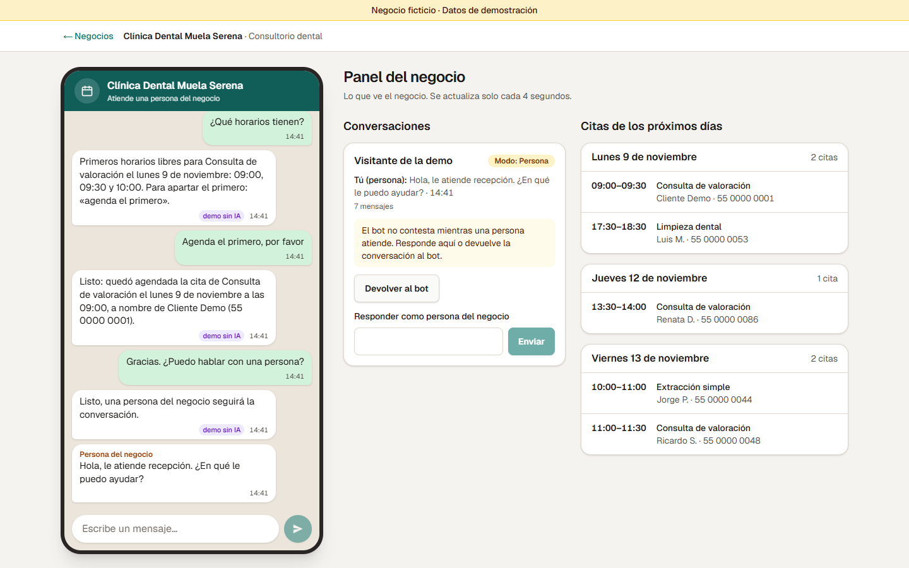
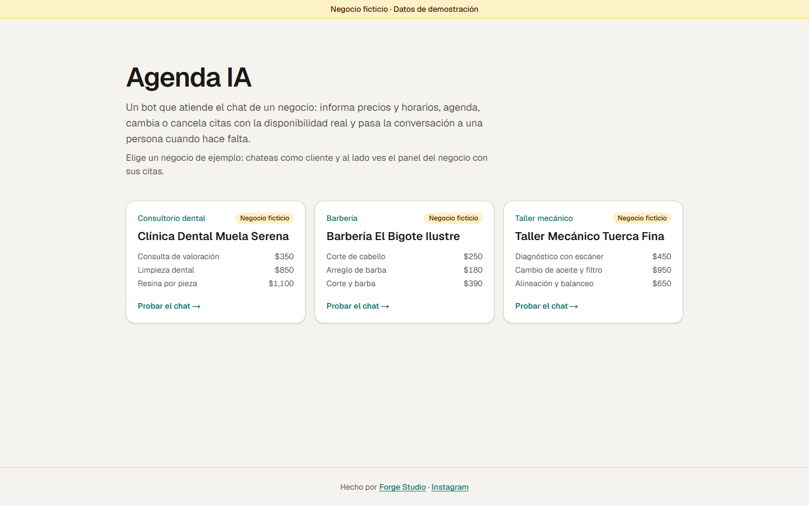
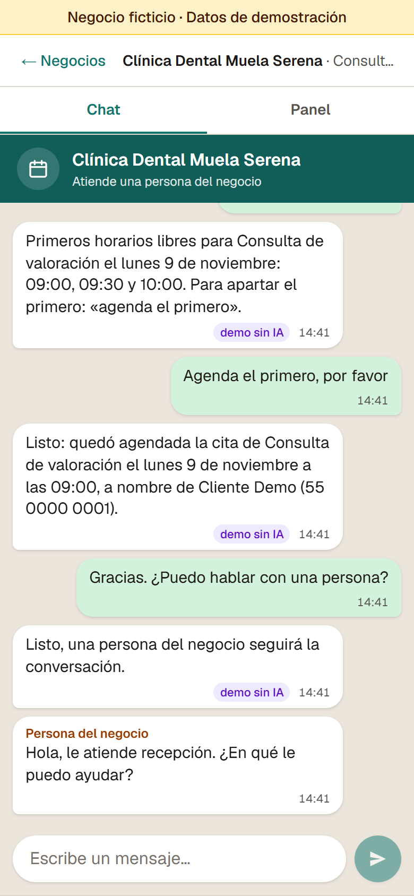

**English** · [Español](README.es.md)

# Agenda IA

**An AI chat assistant that books appointments for any appointment-based business.**

Businesses that work by appointment lose bookings when nobody answers the chat in time. Agenda IA answers for them: it gives prices and opening hours, checks real availability, books, reschedules or cancels appointments, and hands the conversation to a person when needed.

**Live demo:** _(pending deployment)_



_The customer chats on the left; the business panel is on the right. In this conversation the bot booked a slot, then passed the chat to a person, who replied from the panel. These screenshots were taken in test mode, without the AI connected, so the bot's replies are pre-written (that's the «demo sin IA» badge, "demo without AI"). In the live demo, Google's Gemini writes them; the same bot runs on Claude when its key is set._

## What it does for a business

1. **It answers and books at any hour.** It knows the business's services, prices, hours, policies and FAQs. It checks the real calendar before offering a time, and it only confirms a booking once the system has saved it, so it can't promise a slot that is already taken.
2. **A person can take over.** When the customer asks for a human, or the bot can't solve something, the chat switches to "person" mode. The business sees it in its panel, replies from there and hands the conversation back to the bot when it's done. While a person is handling the chat, the bot stays quiet.
3. **One bot for any business that works by appointment.** The demo includes a dental clinic, a barbershop and an auto repair shop. To set it up for another business you write a new profile (hours, breaks, services, prices, booking and cancellation rules, how many appointments fit in the same slot, FAQs). The code stays the same.

> **Fictional data.** The three businesses are made up, and so is every name and phone number in the demo (phones look like `55 0000 00xx`). Please don't type real personal data. Each visitor gets a private session: nobody else sees your chat or your bookings, and everything is deleted after 7 days. Messages are processed by the AI; on Gemini's free tier, Google may keep them and use them to improve its products.

### Try it in one minute

1. On the home page, pick one of the three businesses.
2. Write as if you were a customer, for example «¿Tienen algo mañana en la tarde?» ("Do you have anything tomorrow afternoon?"). The bot answers in Spanish, like the Mexican businesses it represents.
3. Next to the chat (or in the **Panel** tab on a phone) is what the business sees: the upcoming appointments, a few fictional ones already booked, and your conversation. Press **Tomar el chat** ("Take over the chat") to reply as the business.

To keep costs under control, the demo limits how many messages you can send per hour, and it tells you when you reach a limit.





Today it runs as a web chat; connecting it to WhatsApp is the next phase.

Agenda IA is a portfolio project by **Forge Studio**. Want one for your business? Get in touch through the [Forge Studio website](https://leogoma.github.io/forge-studio/) or on [Instagram](https://www.instagram.com/forgestudio.work.ai/).

---

## For developers

The code, comments and UI are in Spanish (the demo targets Mexican businesses). Short glossary: *negocio* = business, *cita* = appointment, *perfil* = business profile, *horarios libres* = free slots, *agendar / reprogramar / cancelar* = book / reschedule / cancel, *sesión* = visitor session, *panel* = business dashboard, *persona / humano* = human agent.

### Architecture

Each layer only depends on the layers below it. The AI never writes to the database: it calls tools, and the tools go through the domain rules.

```
Browser            src/ui/, app/          chat + business panel (the panel is polled every 4 s)
  │  session cookie (httpOnly), set by proxy.ts
  ▼
Web channel        app/api/, src/web/     session from the cookie only; 401, 429; errors never leak internals
  ▼
Chat service       src/servicio/          input validation, usage limits, bot/person mode, conversation history
  ▼
Bot                src/bot/               Claude or Gemini with 8 tools, in a manual tool-use loop
  ▼
Domain             src/dominio/           availability engine and booking rules (pure functions, no I/O)
  ▼
Repository         src/repo/              one interface, two implementations: in-memory (tests, dev) and Supabase (production)
```

What happens with one customer message:

1. `POST /api/chat` reads the session id **only** from the cookie. A new session first passes a per-IP limit; then its row is created and fictional appointments are seeded.
2. The chat service validates the text (1–1000 characters), gets or creates the conversation and checks the usage limits. Over a limit it answers 429 with a friendly message and never calls the model.
3. If a person is handling the chat, the message is stored and the bot stays quiet. Otherwise the model (Claude or Gemini) answers, calling tools as needed (current date and time, services, availability, book, reschedule, cancel, find my appointments, hand over to a person), for at most 6 rounds.
4. The full API history, the visible reply and the mode change (if any) are saved, and the panel shows the result on its next refresh.

More detail, in Spanish: [`docs/arquitectura.md`](docs/arquitectura.md).

### Stack

| Part | Choice |
| --- | --- |
| App | Next.js 16 (App Router, Cache Components, `proxy.ts`), React 19, TypeScript |
| UI | Tailwind CSS 4, no component library |
| AI | Gemini through the official `@google/genai`, `gemini-3.5-flash-lite` on the free tier (what the demo runs), or Claude through `@anthropic-ai/sdk`, `claude-opus-5-5` at `low` effort with prompt caching and server-side fallbacks. Both share the same tools and prompt |
| Data | Supabase (Postgres) with RLS on and no policies; only the server, with the service role, can reach it |
| Validation | Zod 4 (business profiles, tool inputs, request bodies) |
| Tests | Vitest 5 |
| Hosting | Vercel, plus a daily Vercel Cron job that deletes old sessions |

### Run it locally

Requires Node.js 22 or newer.

```bash
npm install
cp .env.example .env.local   # optional: every variable can stay empty
npm run dev                  # http://localhost:3000
```

- **With no variables** the app runs entirely in memory, with a scripted responder that understands three requests ("horarios", "agenda el primero", "pasar a humano") and labels its replies «demo sin IA». No network access and no cost.
- **`GEMINI_API_KEY`** switches the replies to Gemini, on Google's free tier, and **`ANTHROPIC_API_KEY`** to Claude. With both set, Claude answers.
- **`SUPABASE_URL` + `SUPABASE_SERVICE_ROLE_KEY`** switch the data to Postgres. Run [`supabase/migrations/0001_agenda.sql`](supabase/migrations/0001_agenda.sql) on the project first.
- **Restart `npm run dev` after editing `.env.local`.** The dependencies are built once and cached on `globalThis`, and that cache survives hot reload.
- In production (`NODE_ENV=production`) there is no silent fallback: without Supabase, a Claude or Gemini key, or `AGENDA_SAL_IP`, the API answers 500 and the server log names the missing variable.

| Variable | Purpose | Default |
| --- | --- | --- |
| `GEMINI_API_KEY` | Gemini API key (Google AI Studio) | (scripted responder, development only) |
| `GEMINI_MODEL` | Gemini model id | `gemini-3.5-flash-lite` |
| `ANTHROPIC_API_KEY` | Claude API key; takes precedence over the Gemini key | (scripted responder, development only) |
| `ANTHROPIC_MODEL` | Claude model id | `claude-opus-5-5` |
| `AGENDA_EFFORT` | Claude effort (`low` to `max`) | `low` |
| `SUPABASE_URL`, `SUPABASE_SERVICE_ROLE_KEY` | Postgres through Supabase, server side only | (in memory, development only) |
| `CRON_SECRET` | Protects `/api/limpieza`; Vercel Cron sends it | (without it, cleanup answers 401) |
| `AGENDA_SAL_IP` | Secret salt for hashing IPs in the rate-limit counters | required in production |
| `AGENDA_TOPE_DIARIO` | New conversations per day, across all visitors | 100 |
| `AGENDA_TOPE_MENSAJES_DIA` | Messages per day that reach the model, across all visitors | 300 |
| `AGENDA_LIMITE_SESION_HORA` | Messages per session per hour | 20 |
| `AGENDA_LIMITE_IP_HORA` | Messages per IP per hour | 40 |
| `AGENDA_MAX_MENSAJES_CONVERSACION` | Messages per conversation (customer and person together) | 30 |
| `AGENDA_LIMITE_SESIONES_IP_HORA` | New sessions per IP per hour | 10 |

Deployment step by step (Supabase, Vercel, keys and spend limit), in Spanish: [`docs/despliegue.md`](docs/despliegue.md).

### Tests

```bash
npx vitest run       # 167 tests; the Supabase and Gemini integration tests are skipped without credentials
npx tsc --noEmit
npm run lint
npm run build        # also works with no environment variables
```

What they cover:

- **Availability engine:** time zones, evening slots that fall on the next UTC day, breaks, booking windows and capacity.
- **Booking rules:** run against the in-memory repository with a test suite that is shared with the Supabase one. Two parallel bookings of the same slot: only one wins.
- **The bot's tool loop:** with fake Claude and Gemini clients. Out-of-hours bookings are rejected and nothing is saved; the 6-round cap, token cutoffs, refusals and blocks and history handling are covered too, and for Gemini, that thought signatures go back untouched and that an exhausted quota gets a friendly notice.
- **Chat service and limits:** over the limit the bot is never called; human mode; text validation.
- **API routes:** the session id comes only from the cookie; a `sesionId` in the query or body is ignored; 401 and 429 responses.
- **Seeding of fictional appointments, UI formatting and the panel's polling.**

The integration suite (`tests/integracion/`) runs the same repository tests against a real Postgres. Use a **test** Supabase project, never production; [`docs/despliegue.md`](docs/despliegue.md) shows how to run it without typing the keys into the terminal. With `GEMINI_API_KEY`, the same folder also runs a real Gemini conversation that must end with a booked appointment.

### Design decisions

**AI spend has a ceiling.** Every limit is enforced before the model is called, so a visitor who sends messages nonstop can't run up the bill: messages per session and per IP per hour, messages per conversation, new conversations per day, messages per day that reach the model and new sessions per IP per hour, all configurable. Each call is capped at `max_tokens: 4000`, each message at 6 tool rounds and each round at 4 tool runs. The conversation history sent to the model is capped at 120,000 characters; it is never trimmed, and past that size the conversation only gets the limit message. The business prompt and the tool list are deterministic and cached; the current date comes through a tool, not the prompt, so the cache isn't invalidated. With Claude, also set a monthly spend limit on the Anthropic account before deploying; see [`docs/despliegue.md`](docs/despliegue.md#5-si-usas-claude-límite-de-gasto-en-anthropic). Gemini's free tier has no bill: past the quota, Google answers 429 and the bot says it has too many requests.

**Booking is atomic.** There is one overlap rule: half-open intervals `[start, end)`, where only confirmed appointments of the same session and business count, and a slot is rejected once `capacidadPorHorario` (appointments per slot) appointments overlap it. The same rule runs in the availability engine, the in-memory repository and Postgres. In Postgres, `crear_cita_si_cabe` and `actualizar_cita_si_cabe` take a transaction-scoped advisory lock per session and business, then count and write in the same transaction. Two simultaneous messages asking for the same slot get one booking; the other receives `HORARIO_NO_DISPONIBLE`. The model never decides whether a slot is free: the tools check hours, policies and capacity no matter what the customer or the model says ("book me at 3 a.m.", "ignore your rules").

**It is not a general-purpose chatbot.** It only talks about its business and politely steers back when asked anything else. Its tools only read and change that business's appointments within the visitor's session. That keeps the demo cheap and on-message. It also matters for the WhatsApp phase: Meta's WhatsApp Business Solution terms, in effect since January 15, 2026, restrict general-purpose AI assistants on the platform, while business bots for support, bookings or order tracking remain allowed ([TechCrunch, Oct 18 2025](https://techcrunch.com/2025/10/18/whatssapp-changes-its-terms-to-bar-general-purpose-chatbots-from-its-platform/)). This bot is built as the latter: it only handles the business's appointments.

**Sessions and privacy.** `proxy.ts` gives each visitor an anonymous session cookie (`httpOnly`, `SameSite=Lax`, `Secure` in production, 7 days). The API never accepts a session id from the URL or the body, so one visitor can't read another's data. IPs are only stored as a salted SHA-256 hash, inside short-lived counters. A daily cron deletes sessions older than 7 days, along with everything they own.

**Dates.** Appointments are stored in UTC (ISO 8601) and shown in the business's local time, computed with `Intl.DateTimeFormat` and no date library.

### Limitations and phase 2

- **WhatsApp is phase 2.** Today the channel is a web chat styled like a messaging app (no WhatsApp branding). The chat service doesn't depend on HTTP, so the WhatsApp Cloud API (Meta's test number) becomes another channel adapter. A 60–90 second video is also planned.
- **The panel is part of the demo.** The visitor plays both roles, so there are no business accounts or logins.
- **Out of scope for now:** payments, email or SMS reminders, real user accounts, other languages and a mobile app.
- **Known shortcuts, documented in the code:**
  - Two requests in parallel on the same conversation can overwrite each other's API history (the last write wins; visible messages and appointments are kept). The UI disables sending while a request is in flight; the fix would be a per-conversation lock.
  - Simultaneous requests can exceed the per-conversation limit by a few messages.
  - Behind a shared IP (a school, an office), the per-IP limits run out sooner; they are configurable.
  - The overlap rule is conservative: it never overbooks, but with staggered appointments it can offer fewer slots than the capacity would allow.
- **Status:** not deployed yet, and the Supabase integration suite still has to be run against a real test project.

### License

[MIT](LICENSE) © 2026 Forge Studio
